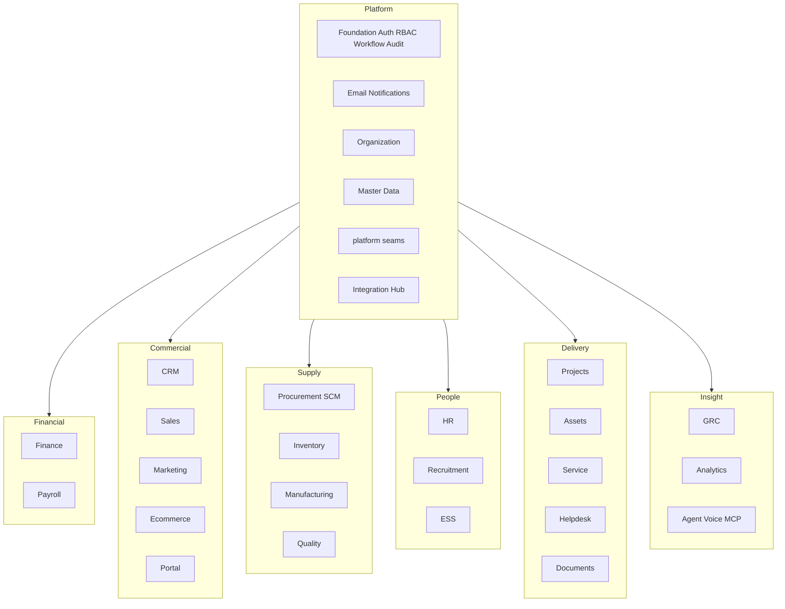

# iConnect Plus — Module Features (as built)

**Document type:** Solution Features Inventory  
**Product:** iConnect Plus (Enterprise ERP)  
**Baseline:** Architecture Lock v1.1 · Addendum v1.2 · ADR-001 · ADR-002  
**Updated:** 2026-10-09  
**Classification:** Internal — Confidential  
**Audience:** Engineering, Product, Architecture, Delivery  

This document is the **features companion** to [`Enterprise_ERP_Master_Architecture.md`](Enterprise_ERP_Master_Architecture.md). It uses the same module portfolio and section shape, but lists **features implemented in code today** (API + admin web + employee ESS surfaces), not the full FRD wishlist.

**Sources of truth for this inventory**

| Layer | Location |
|-------|----------|
| API mount | `apps/api/src/shared/router.py` → `/api/v1` |
| Module packages | `apps/api/src/modules/*` |
| UI registry | `apps/web/src/config/modules.ts` |
| Module nav / sidebars | `apps/web/src/config/*`, workspace nav components |
| Living catalog (short) | [`docs/00_CURRENT/MODULE_CATALOG.md`](../00_CURRENT/MODULE_CATALOG.md) |

When FRD and this document disagree on *what ships today*, treat **code + this document** as current and open an ADR / FRD change if the baseline must move.

---

## Contents

| # | Section |
|---|---------|
| 1 | [Executive Summary](#1-executive-summary) |
| 2 | [How to Read This Document](#2-how-to-read-this-document) |
| 3 | [Product Scope and Module Map](#3-product-scope-and-module-map) |
| 4 | [Platform & Foundation Modules](#4-platform--foundation-modules) |
| 5 | [Financial Modules](#5-financial-modules) |
| 6 | [Commercial Modules](#6-commercial-modules) |
| 7 | [Supply & Operations Modules](#7-supply--operations-modules) |
| 8 | [People Modules](#8-people-modules) |
| 9 | [Delivery & Support Modules](#9-delivery--support-modules) |
| 10 | [Governance & Insight Modules](#10-governance--insight-modules) |
| 11 | [Cross-Domain Flows (as built)](#11-cross-domain-flows-as-built) |
| 12 | [Roadmap — Not Yet Product Features](#12-roadmap--not-yet-product-features) |
| 13 | [Document Hierarchy](#13-document-hierarchy) |

---

## 1. Executive Summary

**iConnect Plus** ships as a **modular monolith** with twenty-plus business domains plus shared platform engines. Every module below is **present in the API router** and (except ESS / public portals) has an admin web entry.

**Depth today falls into three bands:**

| Band | Meaning | Examples |
|------|---------|----------|
| **Deep product UX** | Bespoke dashboards, workflows, and multi-step screens beyond generic resource lists | Finance, CRM, Procurement/SCM, Projects, Assets, HR, Marketing, Service (tickets), Email |
| **API + list UI** | Full (or broad) REST resource set with ModuleHub / workspace sidebar + `ResourceListView` | Sales, Inventory, Manufacturing, Quality, Payroll, Recruitment, Helpdesk, Analytics, Integration, Ecommerce, Portal, GRC, Documents |
| **Thin / partial** | Small intentional surface or scaffolding in progress | Voice agent, Agent read, MCP bootstrap, Landing access-gate; Service generic registry routes disabled |

Shared across all modules: Microsoft Entra SSO + HttpOnly JWT cookies, RBAC permission catalogs, Workflow / Notification / Audit engines, `modules.platform` ports (outbox, numbering, finance posting, stock, approvals), dark slate-teal shell UI with hero KPI cards.

---

## 2. How to Read This Document

### 2.1 Maturity legend

| Status | Meaning |
|--------|---------|
| **Implemented** | Primary flows usable in API + UI for the listed features |
| **Partial** | Core path works; adjacent FRD areas thin, list-only, or gated |
| **Scaffold** | Routers / registry keys exist; UX is mostly generic CRUD |
| **Roadmap** | Documented vision only — not shipped as a product module |

### 2.2 Section template (per module)

Each module section mirrors the Master Architecture catalog:

| Field | Content |
|-------|---------|
| **Web** | Primary admin href(s) |
| **API** | Primary `/api/v1` prefixes |
| **Maturity** | Legend above |
| **Features** | Implemented capabilities (API and/or UI) |
| **Key flows** | End-to-end paths that work today |

---

## 3. Product Scope and Module Map

### 3.1 Domain grouping



### 3.2 Portfolio summary (as built)

| Domain | Modules | Maturity (summary) |
|--------|---------|-------------------|
| Platform | Foundation, Email, Organization, Master Data, Platform seams, Integration | Implemented (Master Data list UX scaffold-heavy) |
| Financial | Finance, Payroll | Finance deep; Payroll Implemented (list + API) |
| Commercial | CRM, Sales, Marketing, Ecommerce, Portal | CRM/Marketing deep; Sales/Ecommerce/Portal list+API |
| Supply | Procurement, Inventory, Manufacturing, Quality | Procurement deep; others Implemented list+API |
| People | HR, Recruitment, ESS | HR deep workspace; Recruitment list+API; ESS Implemented |
| Delivery | Projects, Assets, Service, Helpdesk, Documents | Projects/Assets deep; Service Partial UI; Helpdesk/Documents mix |
| Insight | Analytics, GRC, Agent/Voice/MCP | Analytics/GRC scaffold-rich; AI Partial |

---

## 4. Platform & Foundation Modules

### 4.1 Foundation (Auth, RBAC, Workflow, Audit, Settings)

| | |
|--|--|
| **Web** | `/foundation` |
| **API** | `/auth/*`, `/tenants`, `/users`, `/roles`, `/permissions`, `/modules`, `/workflows/*`, `/notifications/*`, `/audit/*`, `/settings` |
| **Maturity** | Implemented |

**Features**

- Local login, MFA verify, refresh/logout, `/me` (+ avatar)  
- Microsoft Entra OAuth (config, login, callback, exchange)  
- Tenants, users, roles, permissions  
- Module membership / admin-member assignment  
- RBAC with Redis-cached permission resolution  
- Workflow definitions and instances  
- Notification engine API (templates/events used by Email UI)  
- Audit log read  
- System / tenant settings  
- Admin hub screens for all of the above (generic resource lists)

**Key flows:** Authenticate → session cookie → authorized API; submit → workflow approve/reject; mutations audited.

---

### 4.2 Email & Notification System

| | |
|--|--|
| **Web** | `/email` (+ compose, templates, deliveries, events) |
| **API** | `/notifications/*` (foundation) |
| **Maturity** | Implemented |

**Features**

- Email overview dashboard with KPIs  
- Compose UI  
- Templates, deliveries, and event logs  
- Microsoft Graph send path (async via Celery)  
- Device token registration path for push  
- Module user admin (`/email/users`)

**Key flows:** Event → template render → Graph delivery → status logging.

---

### 4.3 Organization

| | |
|--|--|
| **Web** | `/organization` |
| **API** | `/companies`, `/branches`, `/departments`, `/business-units`, `/locations`, `/cost-centers`, `/profit-centers`, `/organization` (tree), `/auth/context` |
| **Maturity** | Implemented |

**Features**

- Multi-company hierarchy; branches; departments; BUs; locations  
- Cost centers and profit centers  
- Org tree view  
- Session org context (company / branch selection)  
- ERP users (`/organization/users`) and module-user mapping (`/organization/module-users`)

**Key flows:** Provision company → branches/depts → assign users → set org context.

---

### 4.4 Master Data

| | |
|--|--|
| **Web** | `/master-data` |
| **API** | `/employees`, `/customers`, `/vendors`, `/products`, `/product-categories`, `/uoms`, `/currencies`, `/taxes`, `/assets` (MD stub), `/warehouses`, `/party-registrations` |
| **Maturity** | Implemented (party registration deep; other masters list scaffold) |

**Features**

- Employee, customer, vendor, product masters  
- Product categories, UoMs, currencies, taxes, warehouses  
- Customer and vendor **registration** workflows (list / new / detail / edit) with KYC/credit via `/party-registrations`  
- Published read projections for other modules (`modules.master_data.published`)  
- Master-data asset stub (distinct from operational Asset Management)

**Key flows:** Party registration → approved master; other modules read masters via published ports (no cross-module ORM writes).

---

### 4.5 Platform seams (ops API)

| | |
|--|--|
| **Web** | (consumed by all modules; home KPIs/charts) |
| **API** | `/platform/slo/*`, `/platform/metrics`, `/platform/ops/status` |
| **Maturity** | Implemented |

**Features**

- Ports / adapters: finance posting, inventory stock, workflow, notify, audit, outbox, numbering, integration  
- Outbox drain/purge Celery tasks  
- Numbering SSOT; approval matrix + `workflow_gate`  
- Optimistic lock (`VersionMixin` → HTTP 409)  
- Field encryption helpers; idempotency records; system job runs  
- Read-model projections (finance / inventory / payroll facts)  
- SLO budgets/alerts/status and ops status surface  
- Architecture CI gates (cross-module ORM, permission catalog, tenant scope)

**Key flows:** Service action → number → optional workflow → outbox → Celery drain → adapters/projections.

---

### 4.6 Integration Hub

| | |
|--|--|
| **Web** | `/integration` |
| **API** | `/integration/*` |
| **Maturity** | Implemented |

**Features**

- External systems, connectors, API credentials, OAuth clients  
- Webhooks, event definitions / subscriptions  
- Message queues, messages, retry queues, dead letters  
- Data mappings / transformations  
- Sync jobs and sync logs  
- API usage, rate limits, monitors, reports  
- Workspace sidebar: Overview, Systems, Connectors, Webhooks, Events, Queues, Sync Jobs, Dead Letters

**Key flows:** Connect → map → sync; webhook ingest → retry / DLQ.

---

## 5. Financial Modules

### 5.1 Finance & Accounting

| | |
|--|--|
| **Web** | `/finance/**` (custom UX + reports) |
| **API** | `/finance/*` |
| **Maturity** | Implemented |

**Features**

- Account groups & chart of accounts (list + create/detail)  
- Fiscal years and periods  
- Journals (create, submit, approve, reject, post, reverse)  
- General ledger inquiry and account drill-down  
- AR and AP workspaces (customer/vendor invoice detail routes)  
- Tax register, currency rates, asset transactions  
- Reports hub: Trial Balance, Balance Sheet, P&L, Cash Flow, Cash Flow Forecast, Treasury Suggestions, GL report, Journal Register, AR/AP Aging, Tax Summary, Cost Center Summary  
- Posting via platform finance ports; SoD / finance-scope hooks  
- Module dashboard with hero KPIs

**Key flows:** Draft journal → approve → post → GL; subledger activity → statements; period close support.

---

### 5.2 Payroll

| | |
|--|--|
| **Web** | `/payroll` (+ `/hr/payroll` shell entry) |
| **API** | `/payroll/*` |
| **Maturity** | Implemented |

**Features**

- Payroll periods and policies  
- Salary structures, components, structure lines  
- Employee salaries and component overrides  
- Earning / deduction types; tax configurations; statutory contributions  
- Payroll runs, run lines, payslips  
- Bonuses, reimbursements, loans / installments, adjustments  
- Payroll postings and summaries; reports  
- Finance posting path for payroll journals  
- Sidebar: Periods, Salaries, Runs, Payslips, Bonuses, Loans, Summaries

**Key flows:** Attendance/leave inputs → run → approve → payslip → GL posting.

---

## 6. Commercial Modules

### 6.1 CRM

| | |
|--|--|
| **Web** | `/crm` (custom sales workspace) |
| **API** | `/crm/*` |
| **Maturity** | Implemented |

**Features**

- **Sales CRM core:** Companies (account workspace), leads, opportunities, quotes, OVF, contacts, products  
- My Jobs approval inbox; OEM quotes; customer POs; sales performance; stock & aging (shared with Procurement)  
- Meetings, customer follow-ups, KYC / account mapping  
- OEM, distributors, BOQ, SOW, entities, end customers  
- Saved report builder (`/crm/reports`)  
- Classic CRM registry: lead sources/assignments/activities, pipelines, stages, campaigns, interactions, tasks, follow-ups, call/email/visit logs, CSAT/feedback  
- Blueprints / actions on leads, opportunities, quotes, OVF  
- GST registrations and customer expense (FOC) ledger paths on companies  
- Attachments, members, lookups, approval step owners, KYC records

**Key flows:** Company → Lead → Opportunity → Quote → OVF → Won/Lost / SCM share; My Jobs approve/reject.

---

### 6.2 Sales

| | |
|--|--|
| **Web** | `/sales` |
| **API** | `/sales/*` |
| **Maturity** | Implemented |

**Features**

- Price lists, discount rules, customer credit  
- Quotations, sales orders, deliveries, invoices, returns  
- Module dashboard + workspace sidebar for primary O2C screens

**Key flows:** Quotation → Order → Delivery → Invoice → AR; returns / credit notes; credit holds.

---

### 6.3 Marketing & Social Media

| | |
|--|--|
| **Web** | `/marketing` (custom workspace) |
| **API** | `/marketing/*` |
| **Maturity** | Implemented (workspace) · Partial vs full FRD depth |

**Features**

- Campaigns (list + detail), operations board, my-work, inbox, tasks, workload  
- Content library, content requests, calendar, brand voices  
- Research, trends, competitors, marketing analytics  
- Social accounts, M365 channel integration  
- Platforms, pillars, publish jobs, approvals, AI/Celery generation pipeline (`/marketing/ai`)  
- Team members and ops surfaces

**Key flows:** Campaign → content request → generate → score → calendar → publish/approve.

---

### 6.4 Ecommerce

| | |
|--|--|
| **Web** | `/ecommerce` |
| **API** | `/ecommerce/*` |
| **Maturity** | Implemented |

**Features**

- Stores, sales channels, product listings (prices / inventory)  
- Customer carts and cart items  
- Orders / order items, payments / payment transactions  
- Shipments and shipping tracking  
- Return requests / return items  
- Coupons, promotions, marketplace connectors  
- Notifications and reports  
- Sidebar: Stores, Listings, Carts, Orders, Payments, Shipments, Returns

**Key flows:** Channel order → pay → fulfill → inventory/sales sync; returns.

---

### 6.5 Customer / Supplier Portal

| | |
|--|--|
| **Web** | `/portal` |
| **API** | `/portal/*` |
| **Maturity** | Implemented |

**Features**

- Portal accounts, customer profiles, sessions  
- Portal dashboards / widgets, notifications, message threads  
- Order and invoice views; document access; download history  
- Support tickets and service requests  
- Saved reports / searches, preferences, devices, login audits  
- Sidebar: Accounts, Profiles, Sessions, Orders, Invoices, Tickets, Service Requests

**Key flows:** Portal login → view commercial docs → raise ticket / service request.

---

## 7. Supply & Operations Modules

### 7.1 Procurement & SCM

| | |
|--|--|
| **Web** | `/procurement` (custom SCM workspace) |
| **API** | `/procurement/*` (+ public order/project tracking) |
| **Maturity** | Implemented (advanced FRD-15 planning Partial) |

**Features**

- Classic P2P: requisitions, RFQs, vendor quotations, comparisons, POs, GRNs, vendor invoices, returns, contracts, vendor performance  
- **SCM workspace:** queue, OVF detail/timeline/preview/hold/charges, PO create/finalize, vendor POs, fulfill-from-stock, item plan, negotiations, ETD, commercial attachments  
- Delivery challan, delivery status, delivery projects/sites  
- Installation and service contracts / service plans & visits  
- Inventory ownership & aging; assign-owner; open-for-sale  
- Sheet trackers; correspondence / mails; approvals; reports; analytics  
- Public: order tracking (PO + email), project tracking by token  
- Module dashboard + deep OVF/PO/GRN routes

**Key flows:** OVF → SCM queue → PO → GRN → challan / delivery project; classic P2P with workflow gates.

---

### 7.2 Inventory & Warehouse

| | |
|--|--|
| **Web** | `/inventory` |
| **API** | `/inventory/*` |
| **Maturity** | Implemented |

**Features**

- Stock balances (on-hand / reserved / available)  
- Bins, batches, serials, reservations  
- Transfers, adjustments, cycle counts  
- Policies (reorder / safety stock)  
- Valuation layers  
- Stock summary / batch expiry reports  
- Platform stock adapter used by GRN / issue / reservation paths

**Key flows:** GRN putaway → reserve → issue/transfer → count/adjust → valuation.

---

### 7.3 Manufacturing

| | |
|--|--|
| **Web** | `/manufacturing` |
| **API** | `/manufacturing/*` |
| **Maturity** | Implemented |

**Features**

- BOMs, routings, work centers, machines  
- Production orders  
- Material issues / returns, production receipts  
- Scrap, WIP, variances, reports  
- Sidebar: BOMs, Production Orders, Issues/Receipts, WIP, Scrap, Machines

**Key flows:** Plan → WO → issue → execute → FG receipt → WIP/variance close.

---

### 7.4 Quality Management

| | |
|--|--|
| **Web** | `/quality` |
| **API** | `/quality/*` |
| **Maturity** | Implemented |

**Features**

- Inspection plans, sampling plans, characteristics, defect types  
- Incoming / in-process / final inspections  
- Defects, NCRs, CAPAs  
- Supplier quality, complaints, audits, scores, reports  
- Sidebar: IQC / IPQC / FQC, NCRs, CAPAs, Audits, Complaints

**Key flows:** Plan → inspect → release/hold; NCR → CAPA.

---

## 8. People Modules

### 8.1 HRMS

| | |
|--|--|
| **Web** | `/hr` (custom HR workspace) |
| **API** | `/hr/*` (+ `/public/onboarding/*`) |
| **Maturity** | Implemented |

**Features**

- **Workforce:** employee list/detail/new; designations, grades, job levels, employment, management groups, department/designation assignments  
- **Time:** shifts, roster, holiday calendars, attendance, corrections, weekly-off policies, attendance rules, biometric devices, OT allotments, on-duty / comp-off, shift rotations/swaps  
- **Leave:** leave types, balances, requests, adjustments (management page + setup)  
- **Talent / learning:** performance reviews, goals, KPIs, OKRs, appraisals, training (+ rooms, attendance, requests)  
- **ESS bridge:** ESS inbox, ESS policies, org docs; `/hr/ess` shell  
- **Lifecycle:** separation, offboarding, digital onboarding (admin + public token portal)  
- **IT Admin:** stocks, travel, requisition, meeting rooms, employee assets/documents  
- Reports, roster, setup, superadmin, module users  
- Registry CRUD mirrors for HR resource keys

**Key flows:** Hire-to-retire; leave/attendance approval; digital onboarding portal → HR case; ESS handoff.

---

### 8.2 Recruitment

| | |
|--|--|
| **Web** | `/recruitment` (+ `/hr/recruitment` entry) |
| **API** | `/recruitment/*` |
| **Maturity** | Implemented |

**Features**

- Job requisitions and postings  
- Sources, recruiters, candidates, resumes, candidate documents/notes  
- Applications and application stages  
- Interviews and interview feedback  
- Offers and offer approvals  
- Background verification, reference checks, talent pools  
- Onboarding cases and onboarding tasks  
- Reports  
- Sidebar: Requisitions, Postings, Candidates, Applications, Interviews, Offers, Onboarding

**Key flows:** Requisition → apply → interview → offer → BGV → onboard → HR employee.

---

### 8.3 Employee Self-Service (ESS)

| | |
|--|--|
| **Web** | Employee app / ESS surfaces (`/hr/ess*`; `apps/employee-app`) |
| **API** | `/ess/*` |
| **Maturity** | Implemented (API + employee-app) |

**Features**

- Profile (bank, KYC, emergency, education), change password, face security hooks  
- Leave types/balances/requests and corrections  
- Attendance punch + policy; WFH / on-duty / comp-off  
- Manager team approvals (leave, comp-off, on-duty, corrections, WFH)  
- Payslips, documents, holidays, announcements, notifications  
- Assets (+ tickets), training, performance, separation  
- Meeting rooms, support tickets, policies  
- Device tokens for push

**Key flows:** Employee self-serve leave/attendance → manager approve → HR/payroll consume.

---

## 9. Delivery & Support Modules

### 9.1 Project Management

| | |
|--|--|
| **Web** | `/projects` (custom delivery workspace) |
| **API** | `/projects/*` |
| **Maturity** | Implemented |

**Features**

- Projects CRUD + detail workspace (assign, configuration, stage workflows)  
- Phases, milestones, tasks (dependencies/assignments), timesheets / entries  
- Resource plans / allocations; budgets, costs, profitability  
- Issues, risks, change requests, documents, comments, status history, notifications  
- **Site installation delivery:** survey → SCM → onsite/material handover → installation → acceptance  
- My Jobs / completed jobs, follow-ups, stage alerts, PO queue, customer trackers  
- Member vs manager dashboards with hero KPI grids  
- Reports

**Key flows:** Approve project → plan → site workflow stages → timesheet cost → acceptance / close.

---

### 9.2 Asset Management

| | |
|--|--|
| **Web** | `/assets` (+ Non-IT domain) |
| **API** | `/assets/*` |
| **Maturity** | Implemented |

**Features**

- **IT:** categories/types, asset register (new/detail/edit), components  
- Incoming assets, QC, registration queue  
- Assignments (+ return), DC challans, transfers, maintenances  
- Locations / site locations / buildings; warranties; insurance  
- Maintenance plans, service histories, checklists, meter readings  
- Depreciation, disposals, revaluations, audits, documents, notifications, reports  
- Inventory import; information portal / self-service asset views  
- QR / barcode support  
- **Non-IT:** dashboard, inventory, types, locations, asset detail, assign/unassign, maintain, dispose, import  
- Domain memberships

**Key flows:** Incoming → register → assign → maintain → depreciate → dispose; Non-IT parallel register.

---

### 9.3 Service Management

| | |
|--|--|
| **Web** | `/service` (SOP ticket UX) |
| **API** | `/service/*` |
| **Maturity** | Partial (ticket UX deep; generic registry UI disabled) |

**Features**

- Service request tickets (list / new / detail / edit)  
- Mailbox (inbound email), field-engineer workspace, resolved tickets  
- Service SLAs  
- Full API also exposes: categories, requests, tickets, assignments, schedules, work orders, tasks, checklists, visits, materials, time entries, expenses, escalations, feedback, resolutions, documents, notifications, contracts, reports  
- Admin web intentionally **does not** expose generic `/service/{resource}` lists (`ALLOWED_SERVICE_RESOURCES` empty)

**Key flows:** Inbound/request → ticket → assign → resolve → SLA/feedback.

---

### 9.4 Helpdesk

| | |
|--|--|
| **Web** | `/helpdesk` |
| **API** | `/helpdesk/*` |
| **Maturity** | Implemented |

**Features**

- Ticket categories, priorities, tickets, assignments  
- Status history, comments, attachments, activities  
- SLAs, escalations  
- Knowledge bases / articles, resolutions  
- Support teams, shifts, schedules  
- Customer feedback, notifications, reports, dashboards  
- Sidebar: Tickets, Assignments, Escalations, Knowledge, Resolutions, Teams, Feedback

**Key flows:** Report → assign → resolve → CSAT; SLA breach → escalate.

---

### 9.5 Document Management (DMS)

| | |
|--|--|
| **Web** | `/documents` (+ PDF editor) |
| **API** | `/documents/*` |
| **Maturity** | Partial / scaffold-rich (storage/OCR hardening ongoing) |

**Features**

- Folders, documents, versions, metadata  
- Tags, permissions, shares, comments  
- Approvals, workflows, checkouts, audits, attachments  
- Templates / template fields  
- Retention policies, archives  
- Notifications, reports  
- **PDF editor** (`/documents/pdf-editor`) for fill/sign  
- Object storage via MinIO/S3; ClamAV on upload  
- Sidebar: Folders, Documents, Versions, Approvals, Templates, Retention, Archives

**Key flows:** Upload → review → approve → publish; retain → archive.

---

## 10. Governance & Insight Modules

### 10.1 GRC (Governance, Risk, Compliance)

| | |
|--|--|
| **Web** | `/grc` (+ `/grc/compliance` hub) |
| **API** | `/grc/*` |
| **Maturity** | Scaffold / broad CRUD (+ dashboard) |

**Features**

- Overview / compliance monitor  
- Policies, versions, acknowledgements  
- Controls and control tests  
- Risk categories, registers, assessments, treatments  
- Compliance frameworks, requirements, assessments  
- Audit plans, audits, findings  
- Corrective actions, exceptions, incidents  
- Notifications, reports  
- Sidebar: Policies, Risks, Controls, Compliance, Audits, CAPA, Incidents

**Key flows:** Risk identify → assess → treat → control test; audit → finding → CAPA; policy lifecycle.

---

### 10.2 Analytics (BI)

| | |
|--|--|
| **Web** | `/analytics` |
| **API** | `/analytics/*` |
| **Maturity** | Implemented |

**Features**

- Dashboards and dashboard widgets  
- Reports, schedules, executions  
- Datasets, dataset sources, fact tables, snapshots, refreshes  
- Metrics, KPIs, dimensions  
- Alert rules and alert notifications  
- Subscriptions, data exports / imports  
- Query history, usage audits  
- Sidebar: Dashboards, Reports, KPIs, Datasets, Metrics, Alerts, Exports  
- Platform home consumes module KPI feeds for executive view

**Key flows:** Dataset → metric/KPI → dashboard/report → schedule/alert.

---

### 10.3 Platform AI surfaces (Agent / Voice / MCP)

| | |
|--|--|
| **Web** | `/voice-agent` |
| **API** | `/voice-agent/*`, `/leads|/orders|/invoices` + `/agent/*` (agent_read), `/mcp` (separate mount) |
| **Maturity** | Partial / in progress |

**Features**

- Voice assistant UI (ElevenLabs conversational)  
- Signed WebSocket URL API for voice agent  
- Read-only agent endpoints for leads, orders, invoices, customers, products  
- MCP streamable HTTP server mounted at `/mcp` (tools from OpenAPI config)  
- Full LLM gateway, permission-aware RAG, Virtual E.A. — **roadmap** (§12)

**Key flows:** Open voice agent → signed URL session; agent tools read curated APIs via MCP/agent_read.

---

### 10.4 Landing / access gate

| | |
|--|--|
| **Web** | Marketing / landing surfaces |
| **API** | `/public/access-gate/*` |
| **Maturity** | Scaffold-thin |

**Features:** Access-code verify + gated session for public marketing site.

---

## 11. Cross-Domain Flows (as built)

### 11.1 Procure-to-pay

```text
Requisition → (workflow) → RFQ / Vendor quote → PO → GRN
        → stock via IInventoryStock → AP invoice → Finance payment
```

OVF-driven path: **CRM OVF → Procurement SCM queue → PO → GRN → Delivery challan**.

### 11.2 Order-to-cash

```text
CRM lead / opportunity → Quote → OVF / Sales order → Delivery → Invoice
        → AR / journal posting via IFinancePosting
```

### 11.3 Inventory movement

```text
Reservation / transfer / adjustment / GRN / issue
        → InventoryStockAdapter → stock ledger
        → optional outbox domain.inventory.* → analytics facts
```

### 11.4 Hire-to-retire

```text
Recruitment → Master employee → HR employment / leave / attendance
        → ESS self-service → Separation → F&F via payroll → Finance
```

### 11.5 Asset lifecycle

```text
Incoming / Register → Assignment / Transfer → Maintenance → Disposal / Revaluation
DC challan ↔ SCM (see docs/09_OPS/dc-challan-scm-contract.md)
```

### 11.6 Project site delivery

```text
Project / site → Survey → SCM → Onsite / Material handover
        → Installation → Acceptance → Tracker / My Jobs
```

### 11.7 Platform side effects

```text
Service action
  ├─ number via SSOT numbering
  ├─ start workflow if APPROVAL_POLICIES mode=workflow
  ├─ enqueue outbox (notify / audit / finance / integration / domain)
  └─ Celery drain → adapters → projections
```

---

## 12. Roadmap — Not Yet Product Features

These remain product vision for full GA (also §12 in the Master Architecture). Thin API/UI already exists for agent/voice/MCP (§10.3).

| Extension | Target (not shipped as full module) |
|-----------|-------------------------------------|
| AI Assistant & AI Infra | LLM gateway, permission-aware RAG, in-module copilots, guardrails |
| Virtual E.A. | Executive assistant across modules |
| Licensing & Activation | Entitlement service disabling unlicensed APIs/UI/jobs |
| Backup & DR | Productized backup jobs, restore runbooks UI |

OpenSearch, Kubernetes/EKS extraction, and warehouse extract remain **evolution-gated** (`modules/platform/evolution.py`).

---

## 13. Document Hierarchy

| Document | Role |
|----------|------|
| [`Enterprise_ERP_Master_Architecture.md`](Enterprise_ERP_Master_Architecture.md) | Solution architecture, deploy topology, principles |
| **This document** | Per-module **as-built features** inventory |
| [`docs/00_CURRENT/SYSTEM_OVERVIEW.md`](../00_CURRENT/SYSTEM_OVERVIEW.md) | Stack, platform seams, request/async paths |
| [`docs/00_CURRENT/MODULE_CATALOG.md`](../00_CURRENT/MODULE_CATALOG.md) | Short API/UI mount map + primary flows |
| `docs/02_FRD/*` | Baseline functional requirements (intent) |
| `docs/05_ARCHITECTURE_LOCK/*` | Locked decisions |

**Maintenance:** When a module gains a material feature (new bespoke workflow screen or API domain), update the matching section here and the short row in `MODULE_CATALOG.md` in the same change set when practical.
