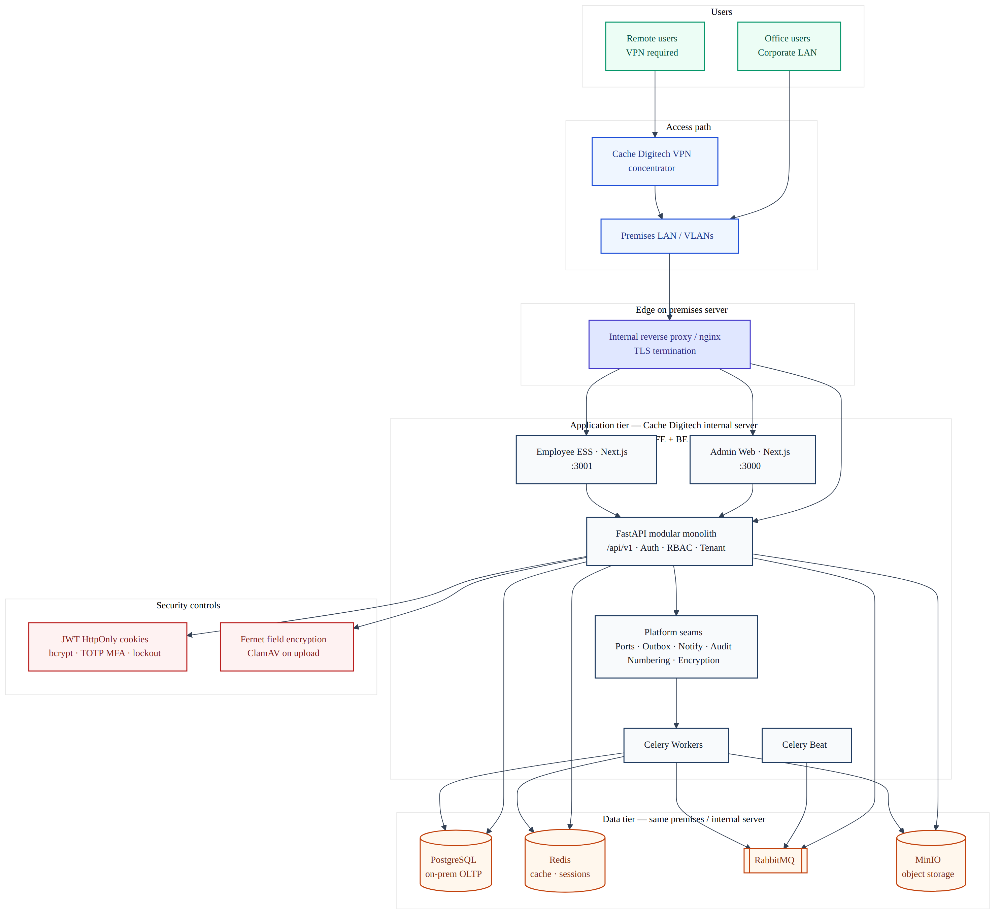

# Solution Architecture (HLD & LLD)

**Ref:** 1.1  
**Product:** iConnect Plus  
**Organisation:** Cache Digitech  
**Classification:** Internal — Confidential  
**Version:** 2.0  
**Date:** 2026-11-03  
**Deployment model:** On-premises (Cache Digitech premises) · VPN for remote access  
**Audience:** Security assessors, infrastructure owners, platform engineering, module leads

---

## 1. Purpose

This document describes the **high-level (HLD)** and **low-level (LLD)** solution architecture for **iConnect Plus** as deployed on **Cache Digitech on-premises infrastructure**. It replaces any prior narrative that treated AWS RDS/S3, Coolify public SaaS, or internet-exposed multi-tenant hosting as the primary production model for this security pack.

## 2. Scope

| In scope | Out of scope (this pack) |
|----------|---------------------------|
| On-prem Docker Compose runtime on company LAN | Public SaaS / shared cloud tenancy as primary prod |
| Admin web (Next.js), ESS app, FastAPI API | Microservice extraction (evolution-gated) |
| PostgreSQL, Redis, RabbitMQ, MinIO, ClamAV | Optional future OpenSearch hardening details |
| Celery workers & beat | Third-party HRMS internals |

## 3. Architectural principles (locked)

| Principle | Implementation |
|-----------|----------------|
| Modular monolith | Single FastAPI deployable; bounded contexts under `apps/api/src/modules/*` |
| Clean Architecture + DDD | Router → Service → Repository → Database |
| Tenant isolation | `tenant_id`, `company_id`, `branch_id` on transactional data |
| Soft delete | No physical DELETE on business tables |
| UUID primary keys | All OLTP entities |
| Platform engines | Workflow, Notification, Audit — not bypassed |
| AuthZ | RBAC permission catalog; Redis-backed resolution |

Baseline references: `docs/05_ARCHITECTURE_LOCK/ERP_Architecture_Lock_Report_v1.1.md`, `docs/00_CURRENT/SYSTEM_OVERVIEW.md`.

## 4. High-level design (HLD)

### 4.1 Context

- **Users (office):** Corporate LAN → internal reverse proxy (TLS) → application tier.
- **Users (remote):** Internet → **Cache Digitech VPN** → LAN → same application entry point.
- **Application is not** marketed or operated as a public internet SaaS endpoint in this deployment model.

### 4.2 Figure 1 — Solution HLD



*Figure 1. Trust zones: VPN boundary, LAN, Docker host, data tier. Diagram asset pending final render — link retained for compliance pack.*

### 4.3 Logical tiers

| Tier | Components | Responsibility |
|------|------------|----------------|
| Presentation | `erp-web` (Next.js 16+), `erp-employee-app` (ESS) | UI, server components, BFF proxy to API |
| Edge / TLS | `erp-nginx` on premises host | TLS termination, route to web/API |
| Application | `erp-api` (FastAPI, Python 3.13+) | REST `/api/v1`, auth, RBAC, domain services |
| Async | `erp-celery-worker`, Celery Beat | Outbox drain, notifications, domain jobs |
| Data | `erp-postgres`, `erp-redis`, `erp-rabbitmq`, `erp-minio`, `erp-clamav` | OLTP, cache/sessions, broker, objects, AV scan |
| Observability | Platform metrics/SLO routes (internal) | Health, ops status |

### 4.4 Typical request path (sync)

```text
Browser ──HTTPS──► Nginx (:8443) ──► Next.js / FastAPI
                                      │
                         JWT (HttpOnly cookies) + RBAC
                                      │
                         Service ──► Repository ──► PostgreSQL
                                      │
                         Outbox ──► Celery ──► notify / audit / integrations
```

### 4.5 Object and file storage

| Store | Technology | Location |
|-------|------------|----------|
| OLTP | PostgreSQL 16 | On-prem Docker volume `erp_pgdata` |
| Documents / attachments | MinIO (S3-compatible API) | On-prem; `S3_ENDPOINT_URL` internal |
| Upload safety | ClamAV (`clamd`) | On-prem; optional via `CLAMAV_ENABLED` |
| Field-level secrets | Fernet (`FIELD_ENCRYPTION_KEYS`, `PII_ENCRYPTION_KEY`) | Application layer |

## 5. Low-level design (LLD)

### 5.1 Repository layout

| Path | Role |
|------|------|
| `apps/web/` | Admin UI |
| `apps/employee-app/` | ESS / employee portal |
| `apps/api/` | FastAPI, Alembic, Celery workers |
| `docker-compose.infra.yml` | Postgres, Redis, RabbitMQ, MinIO, ClamAV, OpenSearch |
| `docker-compose.app.yml` | API, Celery, web, ESS, nginx |
| `docker/nginx/` | TLS certs, reverse proxy config |

### 5.2 Docker network

- Shared bridge network **`erp-net`** connects infra and app containers on the **internal application server** (example ops host: `172.16.200.30`).
- Database and MinIO are reachable only on LAN/VPN paths; host port publishing is restricted per environment policy.

### 5.3 Security controls (application)

| Control | Mechanism |
|---------|-----------|
| Authentication | Username/password (HRMS-linked), optional Microsoft OAuth |
| MFA | TOTP (`mfa_enabled` on user) |
| Session | JWT access + refresh in **HttpOnly** cookies (`erp_access_token`, `erp_refresh_token`) |
| Password hashing | bcrypt |
| Authorization | `require_permission` + tenant context |
| Rate limiting | Configurable login/API/write/upload limits |
| API documentation | OpenAPI gated by `ENABLE_API_DOCS` (default **false**) |
| Demo accounts | `ALLOW_DEMO_LOGIN` must be **false** in production |

### 5.4 Multi-tenancy data model

- All business mutations scoped by authenticated **tenant context**.
- Optimistic concurrency via `version` column → HTTP **409** on stale updates.
- Sensitive attributes encrypted at rest via SQLAlchemy encrypted types.

### 5.5 Async / integration

| Component | Use |
|-----------|-----|
| RabbitMQ | Celery broker |
| Redis | Celery results, permission cache, rate-limit counters |
| Outbox table | Reliable side-effects (notify, audit, finance postings) |

## 6. Environment matrix (on-premises)

| Environment | Host pattern | Access | Evidence |
|-------------|--------------|--------|----------|
| Development | Dev VM / engineer workstation | LAN or VPN | **Template / Pending sign-off** |
| Test / UAT | Internal server (non-prod VLAN) | LAN + VPN | **Template / Pending sign-off** |
| Production | Cache Digitech premises server | LAN + VPN only | **Template / Pending sign-off** |

## 7. Non-functional requirements (summary)

| NFR | Target (on-prem) | Owner |
|-----|------------------|-------|
| Availability | Per IT SLA for internal apps | Cache Digitech IT |
| Backup / DR | Postgres + MinIO volume backup | IT + Platform (**Template / Pending sign-off**) |
| Patch cadence | OS + Docker image updates | IT |
| TLS | Internal CA or org-trusted certs on nginx | IT |

## 8. Related documents

| Ref | Document |
|-----|----------|
| 1.2 | Data Flow Diagram |
| 1.3 | Application Network Diagram |
| 1.5 | Asset & Component Inventory |
| 1.6 | API Specification |
| 1.7 | Infrastructure Shared-Responsibility Matrix |

## 9. Document control

| Version | Date | Author | Change summary |
|---------|------|--------|----------------|
| 2.0 | 2026-11-03 | Platform engineering | On-premises deployment model; removed cloud-primary narrative |
| 1.x | — | — | Superseded |

**Approval:** **Template / Pending sign-off**
