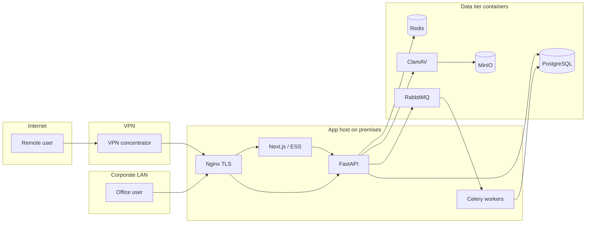

# Data Flow Diagram

**Ref:** 1.2  
**Product:** iConnect Plus  
**Organisation:** Cache Digitech  
**Classification:** Internal — Confidential  
**Version:** 2.0  
**Date:** 2026-11-03  
**Deployment model:** On-premises (Cache Digitech premises) · VPN for remote access  
**Audience:** Security assessors, DPO/privacy reviewers, platform engineering

---

## 1. Purpose

Describe **how data moves** through iConnect Plus on **Cache Digitech on-premises** infrastructure, including **trust boundaries**, **personal data paths**, and **encryption hops**. Primary data paths **do not** traverse public cloud object stores or managed RDS as the system of record.

## 2. Trust boundaries

| Zone | ID | Description | Trust level |
|------|-----|-------------|-------------|
| Internet | Z0 | Untrusted; only VPN endpoints exposed per IT policy | Untrusted |
| VPN | Z1 | Cache Digitech remote-access VPN concentrator | Authenticated users |
| Corporate LAN | Z2 | Office workstations, printers, internal DNS | Authenticated corp devices |
| Application host | Z3 | Docker host (e.g. `172.16.200.30`) running Compose stacks | Privileged platform |
| Container network | Z4 | `erp-net` — east-west between app containers | Platform-internal |
| Data tier | Z5 | PostgreSQL, MinIO, Redis, RabbitMQ volumes | Highest sensitivity |

**Boundary crossings:**

```text
Z0 ──(VPN tunnel)──► Z1 ──► Z2 ──(HTTPS)──► Z3 ──► Z4 ──► Z5
```

There is **no required hop** to AWS S3, AWS RDS, or public SaaS hosting for core OLTP or primary document storage in this model.

## 3. Data categories

| Category | Examples in iConnect Plus | Storage | Retention |
|----------|---------------------------|---------|-----------|
| Credentials | Password hashes, MFA secrets (encrypted), refresh tokens | PostgreSQL | Per account lifecycle |
| Session | JWT claims, session metadata | PostgreSQL + Redis | Configurable TTL |
| PII / employee | Name, contact, tax IDs, bank details | PostgreSQL (encrypted columns where applicable) | HR policy |
| Business transactional | Orders, finance journals, assets | PostgreSQL | Soft-delete + audit |
| Documents | CRM attachments, asset files | MinIO buckets + optional local volumes | Module policy |
| Audit / security | Login events, permission changes | PostgreSQL audit tables | **Template / Pending sign-off** |
| Logs | Request IDs, app logs | Host / container logs | **Template / Pending sign-off** |

## 4. Primary flows

### 4.1 Admin user — authenticated CRUD (office LAN)

| Step | From | To | Protocol | Data | Encryption |
|------|------|-----|----------|------|------------|
| 1 | Browser | Nginx (Z3) | HTTPS (TLS 1.2+) | HTML/JS/API | TLS in transit |
| 2 | Nginx | Next.js / FastAPI | HTTP internal (Z4) | API JSON | Segment trusted (Z4) |
| 3 | FastAPI | PostgreSQL | TCP 5432 (Z5) | SQL + params | TLS optional (**Template / Pending sign-off** for prod enforce) |
| 4 | FastAPI | Redis | TCP 6379 | Cache keys | Segment Z4–Z5 |
| 5 | Service | Outbox → Celery | AMQP | Job payloads | Z4–Z5 |

### 4.2 Remote user — same application path via VPN

| Step | From | To | Notes |
|------|------|-----|-------|
| 1 | User device (Z0) | VPN gateway (Z1) | Org VPN credentials |
| 2 | VPN client | Corporate LAN (Z2) | Split-tunnel policy: **Template / Pending sign-off** |
| 3 | Browser | Same as §4.1 | Application MFA may apply after VPN |

**Network prerequisite:** Remote users **must** connect to Cache Digitech VPN before reaching the application URL.

### 4.3 Employee (ESS) login

| Step | Flow | Controls |
|------|------|----------|
| 1 | ESS app → API `/api/v1/...` auth routes | Employee code / email + password |
| 2 | Optional CAPTCHA | `ESS_LOGIN_CAPTCHA_ENABLED` |
| 3 | MFA challenge | TOTP if `mfa_enabled` |
| 4 | Session cookies issued | HttpOnly, `Secure`, `SameSite` per config |

### 4.4 File upload (with antivirus)

```text
Client ──HTTPS──► API ──► ClamAV (clamd:3310) ──► MinIO (internal endpoint)
                      └──► PostgreSQL metadata
```

| Hop | Encryption / control |
|-----|----------------------|
| Client → Nginx | TLS |
| API → ClamAV | Internal TCP; fail-closed if `CLAMAV_FAIL_OPEN=false` |
| API → MinIO | Internal HTTP(S) per `S3_ENDPOINT_URL`; credentials in env |

### 4.5 Email / notifications

| Path | Destination | Notes |
|------|-------------|-------|
| Notification engine → SMTP | Org mail relay or configured SMTP | Credentials in env; not stored in repo |
| Async delivery | Celery worker | Same on-prem host |

Outbound email crosses **Z0** only at the mail relay — not through application public exposure.

### 4.6 Source code (development lifecycle)

| Path | Flow | Runtime impact |
|------|------|----------------|
| GitHub (`origin` + mirrors) | Developers push code | **No production data** in Git |
| CI (if used) | Build artifacts | **Template / Pending sign-off** |
| Deploy | Image/build on internal server | LAN/VPN restricted |

## 5. Personal data — minimization and purpose

| Purpose | Data used | Legal / policy basis |
|---------|-----------|----------------------|
| Authentication | Login identifier, password hash | Employment / system access |
| HR modules | Employee master, payroll | Employment contract |
| Audit | User id, IP (if enabled), timestamps | Security / compliance |

Cross-border transfer via **public cloud SaaS hosting** is **not** part of the primary on-prem processing path documented here.

## 6. Encryption summary

| State | Mechanism | Key custody |
|-------|-----------|-------------|
| In transit (user → app) | TLS on nginx | IT / Platform |
| In transit (app → DB) | PostgreSQL connection (**policy**) | IT |
| At rest (DB) | Disk encryption on server (**Template / Pending sign-off**) | IT |
| At rest (selected columns) | Fernet field encryption | Platform secrets in env |
| At rest (objects) | MinIO volume + bucket policy | Platform + IT |
| Secrets in config | `.env` on host, not in Git | Platform |

## 7. DFD diagram (logical)



## 8. Related documents

| Ref | Document |
|-----|----------|
| 1.1 | Solution Architecture |
| 1.3 | Application Network Diagram |
| 3.2 | Authentication and Session Design |

## 9. Document control

| Version | Date | Change |
|---------|------|--------|
| 2.0 | 2026-11-03 | On-prem paths; VPN boundary; no public cloud primary hops |

**Approval:** **Template / Pending sign-off**
