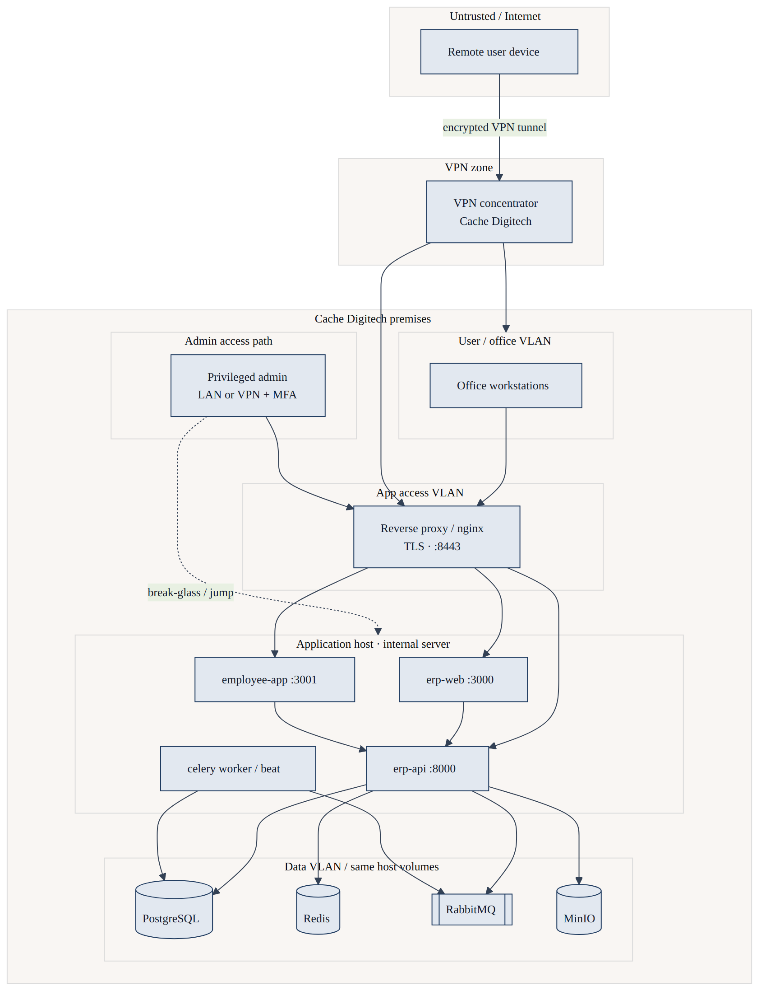

# Application Network Diagram

**Ref:** 1.3  
**Product:** iConnect Plus  
**Organisation:** Cache Digitech  
**Classification:** Internal — Confidential  
**Version:** 2.0  
**Date:** 2026-11-03  
**Deployment model:** On-premises (Cache Digitech premises) · VPN for remote access  
**Audience:** Network operations, security assessors, platform engineering

---

## 1. Purpose

Document the **on-premises network placement** of iConnect Plus: VLAN/LAN segments, VPN entry, reverse proxy, Docker application containers, and data-tier segregation. This document **does not** describe an AWS VPC or public multi-tenant SaaS edge as the primary model.

## 2. Network overview

| Segment | Typical VLAN / subnet | Systems | Access |
|---------|----------------------|---------|--------|
| Corp user LAN | Office user subnet | Workstations | Domain / corp auth |
| Server LAN | Internal server subnet (e.g. `172.16.200.0/24`) | Application Docker host | Restricted ACL |
| Management | IT admin subnet (optional) | SSH, backup, monitoring | Jump host / privileged |
| VPN pool | Remote client addresses | VPN clients | MFA on VPN (**Template / Pending sign-off**) |

Example application host referenced in operations: **`172.16.200.30`**.

## 3. Entry paths

### 3.1 Office users

```text
Workstation (Corp LAN) ──HTTPS──► 172.16.200.30:8443 (nginx) ──► web / api containers
```

### 3.2 Remote users

```text
Remote device ──VPN──► Corp LAN routing ──HTTPS──► 172.16.200.30:8443
```

| Control | Requirement |
|---------|-------------|
| Public internet exposure | Application **not** required to be on public internet |
| VPN | **Mandatory** for out-of-office access |
| Split tunneling | **Template / Pending sign-off** (IT policy) |

### 3.3 Administrators

| Function | Path | Notes |
|----------|------|-------|
| OS / Docker admin | SSH to host from IT network | Key-based; **Template / Pending sign-off** |
| DB admin | `psql` via LAN or port-forward | Not from untrusted networks |
| MinIO console | Internal `:9001` | LAN/VPN only |
| RabbitMQ management | Internal `:15672` | Restricted |

## 4. On-host container topology

Docker bridge network: **`erp-net`**

| Container | Service | Published ports (example prod coexist) | Internal DNS |
|-----------|---------|----------------------------------------|--------------|
| `erp-nginx` | TLS reverse proxy | `8443→443` | `nginx` |
| `erp-web` | Next.js admin | `3000` (optional host bind) | `web` |
| `erp-employee-app` | ESS | `3001` | `employee-app` |
| `erp-api` | FastAPI | `8000` | `api` |
| `erp-celery-worker` | Background jobs | — | — |
| `erp-postgres` | PostgreSQL | `5433→5432` (host coexist) | `postgres` |
| `erp-redis` | Redis | `6379` | `redis` |
| `erp-rabbitmq` | RabbitMQ | `5672`, `15672` | `rabbitmq` |
| `erp-minio` | Object storage | `9000`, `9001` | `minio` |
| `erp-clamav` | Antivirus | `3310` | `clamav` |
| `erp-opensearch` | Search (optional) | `9200` | `opensearch` |

Compose files: `docker-compose.infra.yml` (data tier) + `docker-compose.app.yml` (application tier).

## 5. Segregation controls

| Control | Implementation | Owner |
|---------|----------------|-------|
| LAN firewall | Allow 8443 (and admin ports) only from corp + VPN ranges | Cache Digitech IT |
| Container isolation | Separate containers; no direct DB from browsers | Platform |
| East-west | API only talks to DB on `erp-net` | Platform |
| TLS termination | Nginx with org certs (`docker/nginx/certs/`) | IT + Platform |
| No public SaaS dependency | MinIO + Postgres on same premises host | Platform |

## 6. DNS and URLs (internal)

| Role | Example value | Notes |
|------|---------------|-------|
| Admin UI base | `https://172.16.200.30:8443` | Internal IP or internal DNS name |
| API (browser) | `https://172.16.200.30:8443/api/v1` | Via nginx |
| API (container) | `http://api:8000/api/v1` | `API_INTERNAL_URL` |
| MinIO S3 API | `http://minio:9000` | `S3_ENDPOINT_URL` |

Internal DNS records (if used): **Template / Pending sign-off**

## 7. Logical network diagram



**Figure 1 — Cache Digitech premises network:** remote users must traverse the VPN concentrator before reaching the corporate LAN / app VLAN; office users reach the reverse proxy on the internal server; all frontend and backend containers and data stores run on-premises.

## 8. Ports summary (firewall checklist)

| Port | Service | Source allowed |
|------|---------|----------------|
| 8443 | HTTPS app | Corp LAN + VPN pools |
| 8000 | API direct (dev) | Restrict in prod — prefer nginx only |
| 5433/5432 | PostgreSQL | Localhost / admin jump only |
| 9000/9001 | MinIO | Internal admin |
| 22 | SSH | IT management subnet |

**Production hardening evidence:** **Template / Pending sign-off**

## 9. Related documents

| Ref | Document |
|-----|----------|
| 1.1 | Solution Architecture |
| 1.2 | Data Flow Diagram |
| 1.5 | Asset & Component Inventory |
| 1.7 | Infrastructure Shared-Responsibility Matrix |

## 10. Document control

| Version | Date | Change |
|---------|------|--------|
| 2.0 | 2026-11-03 | Premises LAN/VPN model |

**Approval:** **Template / Pending sign-off**
