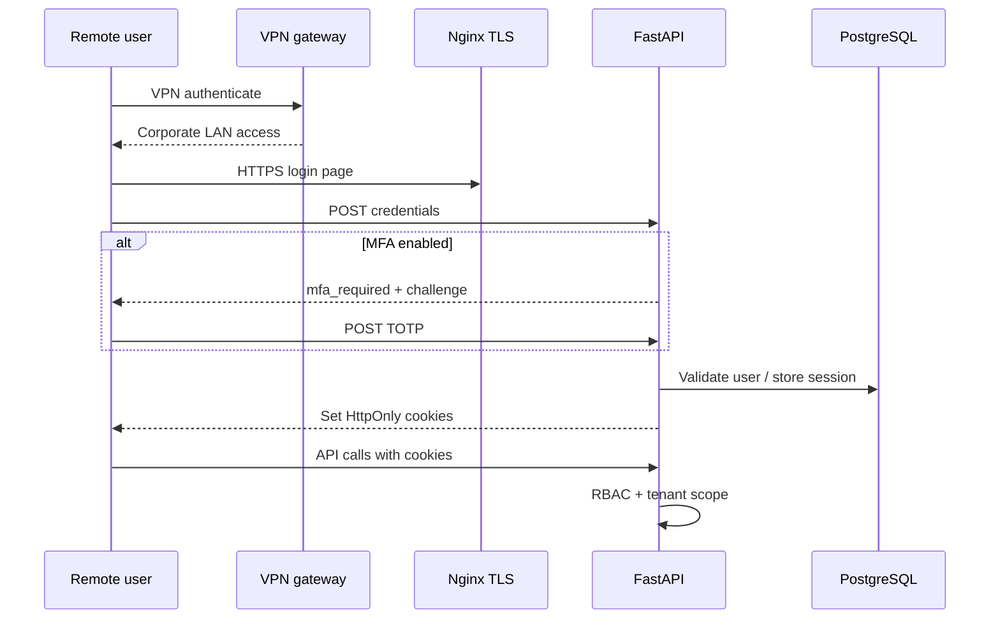

# Authentication and Session Design

**Ref:** 3.2  
**Product:** iConnect Plus  
**Organisation:** Cache Digitech  
**Classification:** Internal — Confidential  
**Version:** 2.0  
**Date:** 2026-11-03  
**Deployment model:** On-premises (Cache Digitech premises) · VPN for remote access  
**Audience:** Security assessors, platform engineering, integrators

---

## 1. Purpose

Document **authentication**, **multi-factor authentication**, and **session management** for iConnect Plus, including **VPN as a network prerequisite** for remote users.

## 2. Defense in depth — access layers

| Layer | Control | Owner |
|-------|---------|-------|
| **Network (remote)** | Cache Digitech VPN required before application reachability | IT |
| **Network (office)** | Corporate LAN membership | IT |
| **Transport** | HTTPS (TLS) at nginx on premises | IT + Platform |
| **Application** | Credentials + optional MFA + RBAC | Platform |
| **Session** | HttpOnly JWT cookies, refresh rotation, binding | Platform |

Remote users **must not** rely on application-level security alone — VPN establishes the first trust boundary (see §1.2 Data Flow, trust Z0→Z1→Z2).

## 3. Identity sources

| Identity type | Source | Notes |
|---------------|--------|-------|
| Admin / back-office user | `sec_user` linked to HRMS email or login id | Password bcrypt hash |
| ESS employee | Employee code / email login | Optional CAPTCHA (`ESS_LOGIN_CAPTCHA_ENABLED`) |
| Microsoft SSO (optional) | Entra ID OAuth | Redirect URI must match internal `FRONTEND_URL` |

## 4. Authentication flows

### 4.1 Password login (admin)

```text
POST /api/v1/auth/login (representative)
  → validate identifier + password
  → if mfa_enabled: return { mfa_required, mfa_challenge_token }
  → else: issue cookies + user payload
```

| Step | Control |
|------|---------|
| Identifier normalization | Sanitized login text |
| Failed attempts | Increment counter; lockout at threshold |
| Demo login block | `ALLOW_DEMO_LOGIN=false` in production |

### 4.2 MFA (TOTP)

| Item | Detail |
|------|--------|
| Algorithm | TOTP (pyotp), 30s window, `valid_window=1` |
| Secret storage | Encrypted on user record (`mfa_secret_encrypted`) |
| Enrollment | User/admin workflow — **Template / Pending sign-off** |
| Verification | Separate endpoint after challenge token |

### 4.3 ESS login

Parallel flow via `login_ess` with employee-specific validation and optional CAPTCHA challenge verification.

## 5. Session design (JWT + cookies)

| Token | Cookie name (default) | Lifetime (configurable) |
|-------|----------------------|-------------------------|
| Access | `erp_access_token` | `JWT_ACCESS_TOKEN_EXPIRE_MINUTES` (privileged: shorter) |
| Refresh | `erp_refresh_token` | `JWT_REFRESH_TOKEN_EXPIRE_DAYS` |

| Cookie attribute | Default | Production expectation |
|------------------|---------|------------------------|
| HttpOnly | Yes | Yes |
| Secure | `AUTH_COOKIE_SECURE=true` | Yes |
| SameSite | `lax` | `lax` or `strict` — **Template / Pending sign-off** |

Server-side session metadata TTL: `SESSION_TTL_SECONDS`.

## 6. Session security controls

| Control | Env flag | Purpose |
|---------|----------|---------|
| Bind access token to User-Agent | `ACCESS_BIND_USER_AGENT` | Reduce token replay |
| Bind access token to IP | `ACCESS_BIND_IP` | Optional stricter mode |
| Bind refresh to User-Agent | `SESSION_BIND_USER_AGENT` | VAPT session hijack mitigation |
| Refresh reuse detection | `REFRESH_REUSE_DETECTION` | Revoke family on stolen refresh |
| Privileged admin shorter JWT | `JWT_PRIVILEGED_ACCESS_TOKEN_EXPIRE_MINUTES` | Limit super-admin window |

## 7. Logout and rotation

| Event | Behavior |
|-------|----------|
| Logout | Clear cookies; invalidate refresh server-side |
| Refresh | Issue new access (and refresh if rotated) |
| Password change | Invalidate other sessions — **Template / Pending sign-off** policy |

## 8. Authorization coupling

After authentication, each request:

1. Validates access JWT from cookie.  
2. Loads user + tenant context.  
3. Evaluates RBAC permission for route.  
4. Applies tenant filters in repository.

See §3.1 RBAC Matrix.

## 9. Rate limiting and lockout

| Mechanism | Settings |
|-----------|----------|
| Login rate limit | `LOGIN_RATE_LIMIT`, `LOGIN_RATE_WINDOW_SECONDS` |
| API rate limit | `API_RATE_LIMIT`, write/upload variants |
| Account lockout | `ACCOUNT_LOCKOUT_THRESHOLD`, `ACCOUNT_LOCKOUT_MINUTES` |

Production values documented in §1.6 — **Template / Pending sign-off**.

## 10. Sequence diagram (remote user)



## 11. Threat considerations

| Threat | Mitigation |
|--------|------------|
| Session theft via XSS | HttpOnly cookies; CSP — **Template / Pending sign-off** |
| Session theft via network | VPN + TLS |
| Credential stuffing | Lockout + rate limits |
| Stolen refresh token | Reuse detection |
| Privilege escalation | RBAC + audit |

## 12. Related documents

| Ref | Document |
|-----|----------|
| 3.1 | RBAC Matrix |
| 1.6 | API Specification |
| 1.2 | Data Flow Diagram |

**Approval:** **Template / Pending sign-off**
